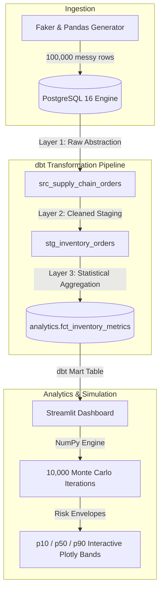

# 📦 Modern Data Stack: E-Commerce Supply Chain & Inventory Risk Project

An end-to-end, executive-grade Modern Data Stack (MDS) portfolio project demonstrating real-world data engineering, dimensional modeling with **dbt**, and statistical inventory optimization via a **10,000-iteration Monte Carlo simulation** rendered in **Streamlit**.

---

## 🏛️ Architecture & Data Flow



---

## 🚀 Key Deliverables

1. **Local Infrastructure (`docker-compose.yml`)**:
   - Spun up with PostgreSQL 16 Alpine, persistent volume storage (`postgres_data`), automatic network bridging, and healthchecks.
   - Pre-seeds `raw` and `analytics` schemas via [init_db/01_init.sql](file:///c:/Users/Mypc/Desktop/Data%20Analyst/init_db/01_init.sql).

2. **Synthetic Data Pipeline (`generate_data.py`)**:
   - Generates **100,000+ realistic transaction rows** using `pandas`, `numpy`, and `Faker`.
   - Injects authentic real-world dirty data patterns:
     - Null discounts (~8%) and missing customer regions (~3%).
     - Unobserved lead times for pending / in-transit orders.
     - Casing and whitespace noise (e.g. ` electronics `, `ELECTRONICS`, `Home & kitchen`).
     - Negative units ordered representing customer returns and scan errors (~1.2%).
     - Intentional duplicate order records (~500 rows) to test ETL deduplication.
     - Fat-tailed lead time delays modeling supply chain port disruptions.
   - High-performance binary streaming via PostgreSQL `COPY` buffer (loads 100k rows in < 4 seconds).
   - Local Parquet caching (`data/raw_supply_chain_orders.parquet`).

3. **dbt Analytics Project (`supply_chain_analytics/`)**:
   - Configured with `profiles.yml` supporting environment variables and dev targets.
   - **Layer 1: `src`** (`models/src/`): Normalizes raw table ingestion and establishes source lineage.
   - **Layer 2: `stg`** (`models/stg/stg_inventory_orders.sql`):
     - Window function deduplication: `ROW_NUMBER() OVER (PARTITION BY order_id ORDER BY order_date DESC)`.
     - Null imputation via `COALESCE`.
     - Title-casing and whitespace trimming.
     - Computed lead time variance: `actual_lead_time_days - promised_lead_time_days`.
   - **Layer 3: `marts`** (`models/marts/fct_inventory_metrics.sql`):
     - Computes daily demand volatility ($\mu_D, \sigma_D$) and lead time volatility ($\mu_L, \sigma_L$).
     - Statistical Safety Stock ($Z = 1.65$ for 95% service level):
       $$SS = 1.65 \times \sqrt{L \cdot \sigma_D^2 + D^2 \cdot \sigma_L^2}$$
     - Reorder Point:
       $$ROP = (D \times L) + SS$$
     - Stockout risk tiering: `CRITICAL`, `HIGH RISK`, `HEALTHY`, and `OVERSTOCKED`.
   - **Data Quality Tests (`models/schema.yml`)**:
     - `not_null` and `unique` on primary keys (`order_id`, `sku_id`).
     - `accepted_values` test on risk tiers.

4. **Executive Dashboard (`streamlit_app.py`)**:
   - Modern dark slate UI with metric cards, status badges, and interactive controls.
   - **10,000-iteration vectorized Monte Carlo simulation** written in pure NumPy (runs in < 0.25 seconds).
   - Plots interactive **p10 (worst-case), p50 (median), and p90 (optimistic)** confidence bands against Safety Stock and Reorder Point thresholds.
   - Scenario stress testing: Lead time variance multiplier (1.0x to 3.0x), forecast horizon, and manual inventory what-if overrides.
   - Fallback architecture: Seamlessly runs from live PostgreSQL or local Parquet cache without configuration overhead.

---

## 📁 Repository Structure

```text
├── docker-compose.yml              # Local PostgreSQL 16 container definition
├── init_db/
│   └── 01_init.sql                 # Automated database schema initializer
├── requirements.txt                # Python library dependencies
├── generate_data.py                # 100k messy record generator & bulk COPY loader
├── run_pipeline.py                 # End-to-end CLI orchestrator
├── streamlit_app.py                # Interactive dashboard with 10k Monte Carlo engine
├── data/
│   └── raw_supply_chain_orders.parquet # Local archive cache
└── supply_chain_analytics/         # dbt project root
    ├── dbt_project.yml             # dbt project configuration & layer materializations
    ├── profiles.yml                # Connection profile for PostgreSQL
    └── models/
        ├── schema.yml              # dbt test definitions (not_null, unique, accepted_values)
        ├── src/
        │   ├── sources.yml         # Raw source table definition
        │   └── src_supply_chain_orders.sql
        ├── stg/
        │   └── stg_inventory_orders.sql
        └── marts/
            └── fct_inventory_metrics.sql
```

---

## ⚡ Quick Start Guide

### 1. Start PostgreSQL
```bash
docker compose up -d
```

### 2. Generate and Ingest 100,000 Records
```bash
python generate_data.py
```

### 3. Run and Test dbt Transformations
```bash
# Navigate to the dbt project or pass directories:
python -c "from dbt.cli.main import dbtRunner; dbtRunner().invoke(['run', '--project-dir', 'supply_chain_analytics', '--profiles-dir', 'supply_chain_analytics'])"
python -c "from dbt.cli.main import dbtRunner; dbtRunner().invoke(['test', '--project-dir', 'supply_chain_analytics', '--profiles-dir', 'supply_chain_analytics'])"
```

### 4. Launch the Streamlit Dashboard
```bash
python -m streamlit run streamlit_app.py
```
Open your browser at `http://localhost:8501`.

---

## 🧮 Statistical Methodology

### Monte Carlo Inventory Simulation Algorithm
For each simulation trajectory $k \in [1, 10000]$ and simulation day $t \in [1, T]$:
1. **Demand Realization**:
   $$D_{t, k} \sim \max(0, \mathcal{N}(\mu_D, \sigma_D))$$
2. **Inventory Depletion**:
   $$I_{t, k} = I_{t-1, k} - D_{t, k}$$
3. **Replenishment Trigger**:
   If $I_{t, k} \le ROP$ and no shipment is in transit:
   $$L_k \sim \max(1, \text{round}(\mathcal{N}(\mu_L, \sigma_L \times \text{multiplier})))$$
   An order of quantity $Q$ is scheduled to arrive at day $t + L_k$.
4. **Percentile Extraction**:
   For each day $t$, risk bands are extracted:
   $$p10(t) = \text{Percentile}(I_{t, :}, 10)$$
   $$p50(t) = \text{Percentile}(I_{t, :}, 50)$$
   $$p90(t) = \text{Percentile}(I_{t, :}, 90)$$
5. **Stockout Probability**:
   $$P(\text{Stockout}) = \frac{1}{N} \sum_{k=1}^N \mathbf{1}\left(\min_{t} I_{t, k} \le 0\right)$$
